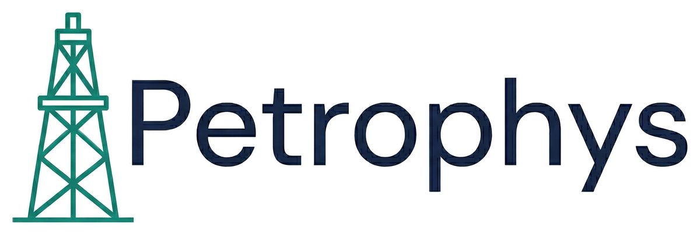
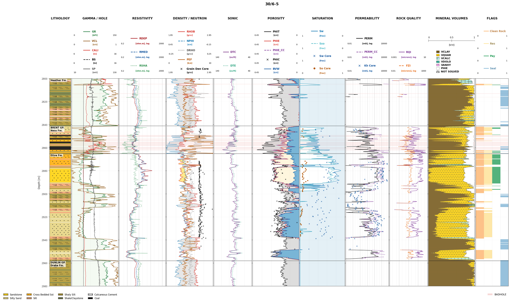

<div align="center">



### From well logs to defensible interpretations.

Petrophys turns well logs, core and specialist measurements into traceable petrophysical interpretations, for
petrophysicists and for the LLM agents that work beside them. Every executed step is recorded and every skipped step
says why, so a person can check the work and a model can cite it.

**[Website](https://welllogbench.com/petrophys/) · [Documentation](https://welllogbench.com/petrophys/docs/) · [Quickstart](https://welllogbench.com/petrophys/docs/quickstart) · [Tutorials](https://welllogbench.com/petrophys/docs/tutorials/) · [API reference](https://welllogbench.com/petrophys/docs/api/) · [PyPI](https://pypi.org/project/petrophys/)**

[](https://pypi.org/project/petrophys/)
[](https://welllogbench.com/petrophys/docs/installation)
[](https://welllogbench.com/petrophys/docs/)
[](https://github.com/sambalshikhar/petrophys/actions/workflows/ci.yml)
[](https://github.com/sambalshikhar/petrophys/blob/main/LICENSE)



<sub>The bundled GeoLink well 30/6-5 across the Brent Group, interpreted and drawn by the <a href="#quick-start">quick start</a> below: the
file's lithology log, conventional logs, porosity, saturation, permeability, rock quality, mineral volumes, core points
and reservoir flags.</sub>

</div>

## Why Petrophys

<table>
<tr>
<td width="33%" valign="top">

**Input-aware**

The workflow checks which curves and parameters a well actually has and runs every step it can. An incomplete log
suite gives a reduced interpretation, not a crash.

</td>
<td width="33%" valign="top">

**Traceable**

Every step records its method, inputs, outputs and parameters; every skipped step records why. Results export as
JSON for review or for LLM agents.

</td>
<td width="33%" valign="top">

**Honest about data**

Implausible or mislabelled curves, geology that misses the logged interval and invalid settings are reported, never
silently "fixed". Values the workflow has to assume, such as the temperature of a given Rw, are reported as warnings.

</td>
</tr>
</table>

## Made for LLMs and agents

Language models know the vocabulary of formation evaluation but cannot compute it. Petrophys gives them the engine.
Through its [MCP server](https://welllogbench.com/petrophys/docs/mcp) an agent loads a well, runs the same validated workflow as `pp.interpret`, reads why
each step ran or was skipped, and answers with numbers it can trace. The wells stay on your machine.

```text
you     Where is the pay in the Brent Group of 30/6-5? Rw is 0.07 ohm.m at 230 °F.

agent   load_sample_well    name="30_6-5", with geology
        interpret_well      Rw 0.07 ohm.m at 230 degF, summary 2841-2958 m
          returns           status, net thickness, skipped steps and warnings with their
                            reasons, assumptions in plain words, review notes
        plot_well           the Brent Group panel

agent   The net pay, citing the steps and settings behind each number.
```

```bash
pip install "petrophys[mcp]"
petrophys-mcp config claude-code --root /path/to/wells   # prints the setup for your client
```

Claude, ChatGPT, Cursor, VS Code and Codex connect on your machine or over HTTP with a token. An invalid setting comes
back with the accepted values, so the model corrects itself, and files stay inside the folders you allow.

<table>
<tr>
<td width="33%" valign="top">

**Tools for the whole workflow**

Load and describe wells, check data quality, interpret one well or a whole field, run your own workflows, explain any
step, summarize zones and plot. [LLM agents](https://welllogbench.com/petrophys/docs/mcp)

</td>
<td width="33%" valign="top">

**Context that fits a prompt**

`pp.export_context` packs an interpretation into compact JSON within a byte budget you set; dataset profiles
reproduce the benchmark context packages for GeoLink, COSTA and the Danish wells. [Context export](https://welllogbench.com/petrophys/docs/context)

</td>
<td width="33%" valign="top">

**Made for code assistants**

[llms.txt](https://welllogbench.com/petrophys/docs/llms.txt) maps the documentation for a model, and `config_schema()` describes every setting as data,
so generated code calls the library correctly.

</td>
</tr>
</table>

### Pair it with PetroHarness

<table>
<tr>
<td width="36%" align="center" valign="middle">
<a href="https://welllogbench.com/petroharness/"></a>
</td>
<td valign="middle">

**An agentic harness that makes formation evaluation auditable and more accurate.** Ask about a well in plain
language: a language model investigates it step by step, Petrophys does every calculation, and every number in the
answer traces back to the log. On WellLogBench, the models we tested score higher with it.

```bash
pip install petroharness
petroharness --launch-ui
```

[GitHub](https://github.com/sambalshikhar/PetroHarness) · [Website](https://welllogbench.com/petroharness/) · [Documentation](https://welllogbench.com/petroharness/docs/)

</td>
</tr>
</table>

[WellLogBench](https://welllogbench.com), a benchmark of LLM reasoning on well logs, builds its well contexts with
Petrophys.

## Install

```bash
pip install petrophys
```

Python 3.10 to 3.13. Optional extras, e.g. `pip install "petrophys[dlis,mcp]"`:

| Extra | Adds |
|-------|------|
| `dlis` | DLIS reading (logs and borehole images) |
| `ml` | Curve imputation and K-means electrofacies |
| `mcp` | MCP server for LLM clients |
| `all` | Everything above |

<details>
<summary>From source, for contributors</summary>

```bash
git clone https://github.com/sambalshikhar/petrophys.git
cd petrophys
python -m pip install -e ".[all,dev,docs]"
```

See [CONTRIBUTING.md](https://github.com/sambalshikhar/petrophys/blob/main/CONTRIBUTING.md) for the verification commands and the pull-request checklist.
</details>

## Quick start

```python
import petrophys as pp

# a bundled well and its formation tops; your own: pp.read("my_well.las", formations=...)
well = pp.read(pp.sample("30_6-5"), formations=pp.sample("formations_30_6-5"))
result = pp.interpret(well, rw=0.070, rw_meas_temp="230 degF")   # Rw (ohm.m) at 230 degF
result.raise_for_errors()

result.print_trace()                            # what ran, what was skipped, and why
pp.plot(result, top=2800, bottom=2980).save("brent.png")       # the figure above

result.to_las("interpreted.las")                # curves plus the settings used
result.to_json("trace.json")                    # full machine-readable trace
```

`pp.read`, `pp.interpret`, and `pp.plot` are the front door. `interpret` works
on a copy of the well; `result.well` holds the interpreted curves (`VCL`,
`PHIE`, `SW`, `PERM`, `NET_PAY`, ...) and `result.config` the settings that
were actually used, including automatically resolved matrix and lithology.

Step through it in the [Quickstart](https://welllogbench.com/petrophys/docs/quickstart), or open it in Google Colab from there with nothing to install.

## What you can do

<table>
<tr>
<td width="50%" valign="top">

**Interpret a whole well**<br>
`pp.interpret` runs nineteen steps, from temperature to net pay, each only when its inputs are there; the trace says
why a step was skipped. [Workflows](https://welllogbench.com/petrophys/docs/workflows)

</td>
<td width="50%" valign="top">

**Bring your own data**<br>
LAS, DLIS, CSV, TSV and Excel logs, formation tops and lithology tables. Vendor mnemonics and units are
standardized, and implausible values are screened. [Your own data](https://welllogbench.com/petrophys/docs/own_data)

</td>
</tr>
<tr>
<td valign="top">

**Check every result**<br>
`result.print_trace()`, warnings for assumed values and suspect curves, and `result.summary()` for any depth
window. [Reviewing an interpretation](https://welllogbench.com/petrophys/docs/workflows.html#review-interpretation)

</td>
<td valign="top">

**Build your own workflow**<br>
Combine built-in steps with your own functions, check the recipe against a well, run it on a field and share it as
JSON. [Custom workflows](https://welllogbench.com/petrophys/docs/custom_workflows)

</td>
</tr>
<tr>
<td valign="top">

**Plot and deliver**<br>
Multi-track log plots, crossplots with chartbook lines, interpreted LAS files and delivery packages.
[Visualization and reporting](https://welllogbench.com/petrophys/docs/visualization_reporting)

</td>
<td valign="top">

**Specialist data**<br>
NMR, spectral gamma, core calibration, saturation-height functions and borehole images.
[Specialist data](https://welllogbench.com/petrophys/docs/specialist_data)

</td>
</tr>
<tr>
<td valign="top">

**Analysis tools**<br>
Gap filling, clay typing, heterogeneity, zonation, Monte Carlo uncertainty and invasion.
[Analysis tools](https://welllogbench.com/petrophys/docs/analysis_tools)

</td>
<td valign="top">

**Run a whole field**<br>
Interpret many wells in one batch, give a zone its own Rw in a zoned run, and compare wells side by side in
multi-well plots. [Workflows](https://welllogbench.com/petrophys/docs/workflows)

</td>
</tr>
</table>

Everything at a glance: [What Petrophys can do](https://welllogbench.com/petrophys/docs/capabilities).

## Reference

<details>
<summary><b>Your own data</b></summary>

```python
well = pp.read(
    "my_well.las",
    formations="formations.csv",   # formation_name, top_depth[, bottom_depth]
    lithology="lithology.csv",     # top, bottom, lithology
)
result = pp.interpret(well, rw=0.05, rw_meas_temp="75 degF", bht="210 degF")
```

Give Rw (ohm.m) with the temperature it was measured at, `rw_meas_temp`
(degF); the workflow corrects it along the well's temperature profile. Without
that temperature, a given Rw, or a header RW without RWT or FMT, is taken at
the well's median formation temperature, with a warning.

CSV, TSV and Excel logs need their depth unit: `pp.read("logs.csv", depth_unit="m")`.
Vendor mnemonics (`GR_EDTC`, `RHOZ`, `TNPH`, ...) and units (kg/m3, percent
porosity) are standardized automatically, in plots and in interpretation.
Physically implausible values are removed on the way, and a curve that is
mostly implausible, which usually means a wrong unit label, raises a warning.
A per-sample lithology code log is read from the curve named by the
`lithology_curve` setting, else from `LITHOLOGY_GEOLINK`, else from a curve
under a lithology-code name, such as `LITHOLOGY` or `FACIES`, that holds
lithology codes. Its codes are decoded with the built-in lithology code table
(Kingdom nomenclature) whatever the curve is called, unless you give its
codebook as `lithology_codes`, and a warning names any curve other than
`LITHOLOGY_GEOLINK`.
Templates for every input ship with the package, e.g.
`pp.sample("formation_tops_template")`; see the
[input templates guide](https://welllogbench.com/petrophys/docs/input_templates) and the
[own-data guide](https://welllogbench.com/petrophys/docs/own_data).

</details>

<details>
<summary><b>Configuring the interpretation</b></summary>

Every setting of `pp.interpret` is a field of `DynamicWorkflowConfig`, with
units in the name (`bht` in degF, `td` in feet) and validation on
creation. The values here are placeholders for your well's:

```python
config = pp.DynamicWorkflowConfig(
    rw=0.05, rw_meas_temp="75 degF",      # formation water
    bht="220 degF", td="8500 ft",           # temperature profile
    sw_model="indonesia",            # or "auto" (the default) to route per sample
    a=1.0, m=2.0, n=2.0,             # Archie parameters, e.g. from SCAL
    skip_steps=["permeability"],
)
result = pp.interpret(well, config)
```

A misspelled or invalid setting fails immediately with the accepted values,
e.g. `hc_type='gass' is not valid; use one of: oil, gas (did you mean 'gas'?)`.

</details>

<details>
<summary><b>Checking the result</b></summary>

```python
result.status                  # "interpreted", "no_interpretation" or "failed"
result.summary(top=2841, bottom=2958)   # compact JSON-ready overview of a depth window
result.warnings                # data problems and assumed values
result.specific_steps_skipped  # e.g. {"core_correction": "Missing core porosity (PHIC/CPOR/CPOR-AMB) or ..."}
result.to_trace_dict()         # every step's method, inputs, outputs, parameters
```

Data problems also raise `petrophys.exceptions.DataQualityWarning`, for example when a
density curve labelled g/cc is really in kg/m3. Turn them into errors with
`warnings.simplefilter("error", DataQualityWarning)`. Values the workflow
had to assume because the data lacked them, such as the temperature of a given
Rw, a temperature gradient or Swirr, are listed in `result.warnings` and in
the `~Other` section of `result.to_las()`.

**Read whole-well totals per formation.** A default run uses one
formation-water salinity for the whole well, with Rw corrected only for
temperature, while shallow formation waters are usually fresher; the clay
indicators also disagree in undercompacted mudstones. Shallow Tertiary
sections that no lithology log covers can therefore show marginal pay, with
SW about 0.5. In the quick-start run on 30_6-5, 22.7 m of the 50.9 m of net
pay lies in the overburden above 1500 m and 25.3 m in the oil column at
2841-2907 m; a default run on 25_5-1 puts 199 m of its 251.0 m of net pay
above its oil zones, which start at 2984 m. Attach formation tops and read
`result.formation_summary()` (or pass `top` and `bottom` to `result.summary`),
or give such a section its own Rw in a zoned run (header zones such as
`TOP_Z1`, `BOT_Z1`, `RW_Z1`; see the
[workflows guide](https://welllogbench.com/petrophys/docs/workflows.html)). A
formation-water salinity that varies with depth is not available.

</details>

<details>
<summary><b>Custom workflows</b></summary>

Build your own reusable recipe from built-in steps and your own functions,
check it against a well, run it on one well or a whole field, and share it as
JSON:

```python
from petrophys.workflow import Workflow, steps

wf = Workflow("Brent Group quick look", [
    steps.clay_volume(method="gr", gr_clean=20, gr_shale=110),
    steps.porosity(method="density", matrix_density=2.65),
    steps.formation_water(rw=0.07, rw_meas_temp="230 degF"),
    steps.saturation(model="archie"),
    steps.net_pay(vcl_cutoff=0.35, phie_cutoff=0.10, sw_cutoff=0.60),
])
run = wf.run(well)                    # checks inputs first; full trace
run.summary(top=2841, bottom=2958)
wf.save("brent_quick_look.json")      # Workflow.load(...) later
```

`steps.interpret(...)` runs the whole prebuilt workflow as one step, so you
can add your own steps around it. See the
[custom workflows guide](https://welllogbench.com/petrophys/docs/custom_workflows.html).

</details>

<details>
<summary><b>Context JSON</b></summary>

```python
context = pp.export_context(result)            # the summary as a dict
pp.export_context(result, "well_context.json")  # or written to a file
```

The versioned API enforces byte budgets and preserves existing files by default.
It supports formation/lithology packages and the `petrophys-context` command.
Packages use your interpretation settings. [Calculation profiles](#calculation-profiles)
explains how to select dataset configurations for benchmark context.
By default, the context classifies each property with its table in
`petrophys.model.CLASS_TABLES`, so a property gets the same class in every
category; reservoir quality needs PHIE, PERM and VCL (`NO_QUALITY_DATA`
otherwise) and uses the limits of each sample's lithology family, clastic or
carbonate.
See the [context guide](https://welllogbench.com/petrophys/docs/context.html) and [interpretation review guide](https://welllogbench.com/petrophys/docs/workflows.html#review-interpretation).
For GeoLink, COSTA and Danish benchmark reproduction, see
[Reproducing the benchmark packages](https://github.com/sambalshikhar/petrophys/blob/main/docs/benchmark_context.md), with commands, required
inputs, output layouts and common errors.
Net-pay output is cutoff screening, not confirmed pay; review warnings and calibration.

</details>

<details>
<summary><b>Use with LLM agents (MCP)</b></summary>

Petrophys includes a [Model Context Protocol](https://modelcontextprotocol.io)
server, so Claude, ChatGPT/OpenAI, Cursor, VS Code, Codex and other MCP clients
can load wells, interpret them, read the trace, summarize zones, plot, and
export results:

```bash
python -m pip install "petrophys[mcp]"                         # Python 3.10+
petrophys-mcp config claude-code --root /path/to/wells         # prints the exact client setup
petrophys-mcp serve --http --root /path/to/wells --token auto  # or serve remote clients over HTTP
petrophys-mcp check --root /path/to/wells                      # verify folders and a test session
```

`docker compose up` runs the HTTP server in a container, and
`examples/mcp_openai_agent.py` connects an OpenAI model to a local server.

The model calls the same validated workflow as `pp.interpret`; invalid settings
come back with the accepted values, and file access is limited to the `--root`
folders. To interpret with the calculations of the GeoLink eval context
benchmark, start the server with `--calculation-profile geolink` (see
[Calculation profiles](#calculation-profiles)). See the
[LLM agents guide](https://welllogbench.com/petrophys/docs/mcp). For
code-generating assistants, the docs also serve
[llms.txt](https://welllogbench.com/petrophys/docs/llms.txt), and
`petrophys.workflow.config_schema()` describes every setting as data.

</details>

<details>
<summary><b>Workflow steps</b></summary>

`pp.interpret` runs these steps in order. Each runs only when its inputs are
available; `result.specific_steps_skipped` explains every skip.

| # | Step | Computes |
|---|------|----------|
| 1 | `normalization` | Canonical curve aliases and units, implausible-value screening |
| 2 | `input_context` | Records which formation and lithology sources were used |
| 3 | `temperature` | Formation temperature profile from BHT or gradient |
| 4 | `bad_hole` | Washout and density-correction quality flags |
| 5 | `vclay` | Clay volume: the lower of GR and neutron-density; SP reported |
| 6 | `rcl` | Clay resistivity from shale intervals |
| 7 | `rmf` | Mud-filtrate resistivity at formation temperature |
| 8 | `hc_correction` | Neutron-density hydrocarbon correction (opt-in) |
| 9 | `porosity` | Density, neutron, sonic, total, effective porosity |
| 10 | `lithology` | Mineral volumes: clastic multi-mineral or carbonate solve |
| 11 | `core_correction` | Porosity and permeability calibrated to core (porosity fitted to PHIT, used only with >= 8 pairs, slope > 0, r^2 >= 0.5) |
| 12 | `rw` | Formation water resistivity at formation temperature |
| 13 | `invasion` | Rxo/Rt from the flushed-zone RXO, then shallow RSHA/RESS, with RMED/RESM as a proxy |
| 14 | `saturation` | Water and flushed-zone saturation |
| 15 | `permeability` | Core-calibrated or empirical permeability |
| 16 | `rock_quality` | RQI, FZI, normalized porosity |
| 17 | `bvw` | Bulk volume water |
| 18 | `mhi` | Moveable hydrocarbon index |
| 19 | `net_pay` | Net rock, net reservoir, and net pay flags |

Spectral-gamma and elemental-spectroscopy interpretation are separate
functions in `petrophys.interpretation.geochemistry`; `pp.interpret` lists
them, and `porosity_refinement`, as skipped. The
[glossary](https://welllogbench.com/petrophys/docs/glossary.html) lists every curve the
workflow adds.

With `sw_model="auto"` (the default), water saturation is routed per sample.
Samples with VCL below `sw_routing_vcl_cutoff` (by default `vcl_cutoff`, or 0.3
when that is unset) get Archie. In shaly rock, carbonate samples get Dual Water
(Clavier, Coates and Dumanoir, 1984) when the bound-water resistivity `rwb` is
given; Rwb is never estimated. All other shaly samples get Waxman-Smits
(Waxman and Smits, 1968) when `cec` (meq/100 g) and `b_coeff`
((S/m)/(meq/cm3)) are given, Simandoux when the formation-water salinity
`salinity_ppm` is at least 20,000 ppm, and otherwise Indonesia, the published
equation of Poupon and Leveaux (1971). The Waxman-Smits saturation, solved on
total porosity, is reported on the effective-porosity basis of the other
models; `pp.interpret` and `steps.saturation` convert `cec` to the meq/g that
the `waxman_smits()` function takes. North Sea and Nigeria-Schlumberger are
available by name. `sw_model="dual_water"` without `rwb`, or `"waxman_smits"`
without `cec` and `b_coeff`, fails the saturation step with a message naming
the missing input. With oil-based mud (`mud_type="OBM"`) no SXO or MHI is
computed, and Rw is not estimated from the SP or Rxo/Rt.

Net pay comes from cutoffs on VCL, PHIE and SW. Cutoffs left unset take the
standard of each sample's lithology family
(`petrophys.evaluation.STANDARD_CUTOFFS`): clastic VCL < 0.40, PHIE > 0.08,
SW < 0.60; carbonate (limestone, chalk, dolomite, marl) VCL < 0.30,
PHIE > 0.045, SW < 0.70. Samples that no lithology log or interval table
classifies take the clastic standards, or the carbonate ones with
`lithology="carbonate"` in `pp.interpret`. Evaporites (from the lithology log or
intervals, or halite recognized from its log response), coal and bad hole are
left out of net reservoir and net pay. The caliper washout and large-hole
tests for `BAD_HOLE` run only where a bit size is known (the BS curve, else a
plausible 3-36 in header value); elsewhere `BAD_HOLE` comes from |DRHO| >
0.15 g/cm3 alone, and a warning names the depths where a caliper reading has
no bit size. The trace lists the cutoffs used per family and the thickness
each exclusion removed.
`steps.net_pay` applies the same rules (`exclude_non_reservoir=False` for the
cutoffs alone).

</details>

<a id="calculation-profiles"></a>

<details>
<summary><b>Calculation profiles</b></summary>

`calculation_profile` selects an interpretation configuration: `"current"` is
the default, and `"geolink"` provides the GeoLink evaluation configuration.
Use a dataset `context_profile` to generate benchmark context: it applies
the collection's preparation, interpretation, calibration and export rules.
See [Reproducing the benchmark packages](https://github.com/sambalshikhar/petrophys/blob/main/docs/benchmark_context.md) for commands and
required inputs.

For an MCP evaluation harness, `petrophys-mcp serve --calculation-profile geolink`
or `PETROPHYS_CALCULATION_PROFILE=geolink` selects the GeoLink configuration.
Settings supplied in a tool call take precedence. The environment variable
is read by the MCP server only.

Dataset profiles are available for GeoLink, COSTA and Danish:

```python
pp.export_context(
    "PATH/eval", "outputs/geolink_context",
    layout="package", context_profile="geolink",
    formations="PATH/NPD stratigraphic picks north sea.xlsx",
    lithology_codes="PATH/Litho_Nomenclature_Kingdom.xlsx",
)
pp.export_context(
    None, "outputs/costa_context",  # None: the COSTA LAS bundled with petrophys
    layout="package", context_profile="costa",
)
```

The Danish profile takes its raw LAS, its tops workbook and the same codebook.
`list_context_profiles()` and `describe_context_profile("danish")` from
`petrophys.reporting` describe them. One script reproduces any of the three
eval collections from a LAS file or folder, keeping the interpreted LAS as
well:

```bash
python scripts/generate_benchmark_context.py --input-dir PATH/HW-31.las --output-dir outputs/HW-31
```

</details>

<details>
<summary><b>Individual calculations</b></summary>

Every model is also a plain function on NumPy arrays or floats:

```python
import numpy as np
from petrophys.interpretation.saturation import archie, dual_water
from petrophys.interpretation.clay_volume import vcl_from_gr
from petrophys.evaluation import calculate_rock_quality

vcl = vcl_from_gr(np.array([35.0, 80.0, 120.0]), gr_min=30.0, gr_max=130.0)
sw = archie(rt=20.0, rw=0.05, phi=0.22)
sw_shaly = dual_water(phi_t=0.2, rt=5.0, rw=0.05, rwb=0.02, vcl=0.3, phi_cl=0.15)
quality = calculate_rock_quality(perm_k=100.0, phi_e=0.2)   # {"RQI", "phi_z", "FZI"}
```

</details>

<details>
<summary><b>Package layout</b></summary>

| Package | Contents |
|---------|----------|
| `petrophys.model` | Wells, curves, core data, intervals, units, constants, class tables |
| `petrophys.io` | LAS, DLIS, CSV, Excel, ASCII and geology readers; LAS/CSV/Excel writers |
| `petrophys.preprocessing` | Standardization, quality control, curve imputation |
| `petrophys.interpretation` | Scientific calculations by property and specialist domain |
| `petrophys.evaluation` | Net pay, rock quality, diagnostics, formation summaries |
| `petrophys.workflow` | The dynamic workflow, zoned and batch processing |
| `petrophys.reporting` | Delivery packages and LLM context export |
| `petrophys.visualization` | Log plots, crossplots, specialist displays |
| `petrophys.datasets` | Packaged sample wells and input templates |

See the [architecture guide](https://welllogbench.com/petrophys/docs/architecture) for
dependency rules.

</details>

## Documentation

| Start here | Guides | Reference |
|---|---|---|
| [Installation](https://welllogbench.com/petrophys/docs/installation) | [Workflows](https://welllogbench.com/petrophys/docs/workflows) | [API reference](https://welllogbench.com/petrophys/docs/api/) |
| [Quickstart](https://welllogbench.com/petrophys/docs/quickstart) | [Custom workflows](https://welllogbench.com/petrophys/docs/custom_workflows) | [The `pp` namespace](https://welllogbench.com/petrophys/docs/api/namespace) |
| [Your own data](https://welllogbench.com/petrophys/docs/own_data) | [Visualization and reporting](https://welllogbench.com/petrophys/docs/visualization_reporting) | [Interpretation settings](https://welllogbench.com/petrophys/docs/api/settings) |
| [New to Python?](https://welllogbench.com/petrophys/docs/new_to_python) | [Context export](https://welllogbench.com/petrophys/docs/context) | [Terms and curves](https://welllogbench.com/petrophys/docs/glossary) |
| [Tutorials](https://welllogbench.com/petrophys/docs/tutorials/) | [LLM agents (MCP)](https://welllogbench.com/petrophys/docs/mcp) | [Input templates](https://welllogbench.com/petrophys/docs/input_templates) |

Releases: [CHANGELOG.md](https://github.com/sambalshikhar/petrophys/blob/main/CHANGELOG.md). Contributing: [CONTRIBUTING.md](https://github.com/sambalshikhar/petrophys/blob/main/CONTRIBUTING.md).

<br>

<p align="center"></p>

## Data and acknowledgements

The sample wells that ship with Petrophys come from public datasets (GeoLink, COSTA, EpsLog, the Kansas Geological
Survey, the Taranaki Basin Curated Well Logs Dataset, Teapot Dome, Daydream 1 and others). They keep their source terms
and attribution requirements: see [THIRD_PARTY_DATA.md](https://github.com/sambalshikhar/petrophys/blob/main/THIRD_PARTY_DATA.md) and
[`petrophys.datasets`](https://github.com/sambalshikhar/petrophys/blob/main/src/petrophys/datasets/README.md). [ACKNOWLEDGEMENTS.md](https://github.com/sambalshikhar/petrophys/blob/main/ACKNOWLEDGEMENTS.md)
credits the methods, data providers and dependencies. Cite the source datasets and method papers relevant to your
work as well as the software.

## Citation

If you use Petrophys in your research, please cite the software and record the version or commit used.
Machine-readable metadata is in [CITATION.cff](https://github.com/sambalshikhar/petrophys/blob/main/CITATION.cff).

```bibtex
@software{petrophys,
  title = {Petrophys: A Python Library for Petrophysical Analysis},
  author = {Petrophys Contributors},
  year = {2026},
  url = {https://github.com/sambalshikhar/petrophys}
}
```

## License

The Petrophys source code is released under the [MIT License](https://github.com/sambalshikhar/petrophys/blob/main/LICENSE). Bundled third-party data keep their own
terms ([THIRD_PARTY_DATA.md](https://github.com/sambalshikhar/petrophys/blob/main/THIRD_PARTY_DATA.md)).
