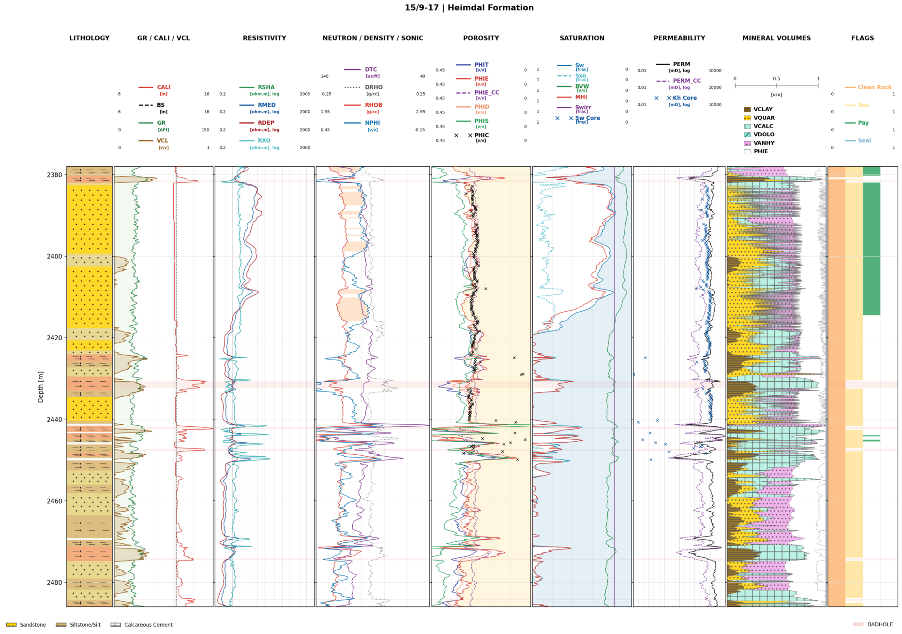

.. title:: Petrophys documentation

.. raw:: html

   <header class="ph-intro">
     
Open-source formation evaluation

     <h1>Petrophys</h1>
     

       A modular Python library for turning well logs, core measurements,
       and specialist data into traceable petrophysical interpretations.
     

     

       <a href="quickstart.html">Run the quickstart</a>
       <a href="api/index.html">Browse the API</a>
     

   </header>

From measurements to decisions
==============================

Petrophys keeps the scientific calculations accessible as independent Python
functions while also providing an input-aware workflow for complete wells.
By default, recognized curve aliases and units are standardized and
implausible values screened before interpretation; every executed, skipped, or
warning-producing step is recorded in the result.

   Formation-scale interpretation of 15/9-17 in the Heimdal Formation,
   showing lithology, conventional logs, porosity, saturation, permeability,
   mineral volumes, core points, and reservoir flags.

From first well to LLM agents
=============================

The documentation follows one path. Each step builds on the one before it.

.. grid:: 1 2 2 4
   :gutter: 2

   .. grid-item-card:: 1. A first well
      :class-card: ph-card-teal
      :link: quickstart
      :link-type: doc

      Install, then read, plot, interpret and export a bundled North Sea well
      in a few lines.

      +++
      Quickstart

   .. grid-item-card:: 2. Your own data
      :class-card: ph-card-teal
      :link: own_data
      :link-type: doc

      Read LAS, CSV and Excel logs, attach formation tops and lithology
      intervals, and check that their depths agree.

      +++
      Your own data

   .. grid-item-card:: 3. Interpret and review
      :class-card: ph-card-amber
      :link: workflows
      :link-type: doc

      Clay volume, lithology and minerals, porosity, Rw, saturation,
      permeability and net pay, with every decision traced and checked.

      +++
      Workflows

   .. grid-item-card:: 4. Your own recipe
      :class-card: ph-card-amber
      :link: custom_workflows
      :link-type: doc

      Fix the methods and parameters, add your own steps, save the recipe and
      run it on a folder of wells.

      +++
      Custom workflows

   .. grid-item-card:: 5. Plots and reports
      :class-card: ph-card-blue
      :link: visualization_reporting
      :link-type: doc

      Adaptive log panels, crossplots and multiwell charts; LAS, CSV, Excel,
      JSON and delivery packages.

      +++
      Visualization and reporting

   .. grid-item-card:: 6. Specialist data and analyses
      :class-card: ph-card-coral
      :link: specialist_data
      :link-type: doc

      NMR, spectral gamma, core, saturation height and borehole images, then
      gap filling, heterogeneity, zonation and uncertainty.

      +++
      Specialist data, then analysis tools

   .. grid-item-card:: 7. Context for LLMs
      :class-card: ph-card-green
      :link: context
      :link-type: doc

      Compact JSON summaries of interpreted wells, by formation and lithology
      group, sized for a language model.

      +++
      Context export

   .. grid-item-card:: 8. LLM agents
      :class-card: ph-card-green
      :link: mcp
      :link-type: doc

      An MCP server that lets a model load, interpret, summarize and plot wells
      on your machine.

      +++
      LLM agents (MCP)

:doc:`What Petrophys can do <capabilities>` maps every part of the library to
its page, and the :doc:`tutorials <tutorials/index>` go deeper.

How data moves through Petrophys
================================

.. raw:: html

   

     

       01 / Inputs
       <strong>Read</strong>
       <small>LAS, DLIS, CSV, ASCII, core, tops and specialist channels</small>
     

     

       02 / Preparation
       <strong>Standardize</strong>
       <small>Aliases, units, nulls, ranges, wellbore quality and provenance</small>
     

     

       03 / Science
       <strong>Interpret</strong>
       <small>VCL, lithology, porosity, electrical properties, Sw and perm</small>
     

     

       04 / Decisions
       <strong>Evaluate</strong>
       <small>Rock quality, flow units, flags, intervals and volumetrics</small>
     

     

       05 / Delivery
       <strong>Explain</strong>
       <small>Computed curves, traces, plots, summaries and export packages</small>
     

   

Input-aware, not all-or-nothing
===============================

Incomplete log suites produce a reduced interpretation with an explicit trace.
Prerequisites are evaluated before each workflow step, so the result explains
what ran, what could not run, and where assumptions or data-quality warnings
need review.

.. raw:: html

   

     

       <strong>Execution record</strong>
       Method, inputs, outputs, parameters and decisions
     

     

       Executed
       <strong>Porosity</strong>
       RHOB and NPHI available
     

     

       Skipped
       <strong>NMR</strong>
       No compatible NMR channels
     

     

       Review
       <strong>Water saturation</strong>
       Inspect assumptions and quality flags
     

   

Start with a bundled well
=========================

The package includes small public datasets, so you can run a complete
interpretation straight after installing:

.. code-block:: python

   import petrophys as pp

   well = pp.read(pp.sample("30_6-5"))
   result = pp.interpret(well, rw=0.07, rw_meas_temp_f=230)  # Rw 0.07 ohm.m at 230 degF

   print(result.status)
   print(result.summary(top=2841, bottom=2958))   # the Brent Group
   pp.plot(result, top=2800, bottom=3000).save("30_6-5.png")

Continue with the :doc:`installation guide <installation>` and the
:doc:`quickstart <quickstart>`, then follow the guide from
:doc:`your own data <own_data>` to :doc:`LLM agents <mcp>`.

.. raw:: html

   

     
     
     
Developed by MBZUAI in collaboration with Inception AI.

   

.. toctree::
   :hidden:
   :maxdepth: 2
   :caption: Getting started

   installation
   quickstart
   own_data

.. toctree::
   :hidden:
   :maxdepth: 2
   :caption: Guide

   capabilities
   workflows
   custom_workflows
   visualization_reporting
   specialist_data
   analysis_tools
   context
   mcp

.. toctree::
   :hidden:
   :maxdepth: 3
   :caption: Learn

   tutorials/index

.. toctree::
   :hidden:
   :maxdepth: 2
   :caption: Reference

   data_model
   input_templates
   glossary
   api/index

.. toctree::
   :hidden:
   :maxdepth: 1
   :caption: Project

   architecture
   benchmark_context
   changelog
